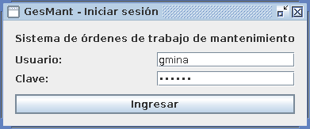
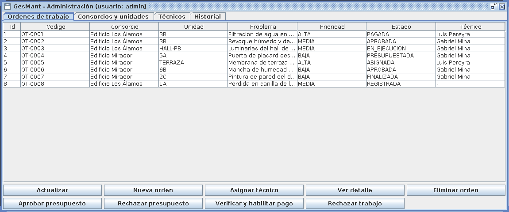
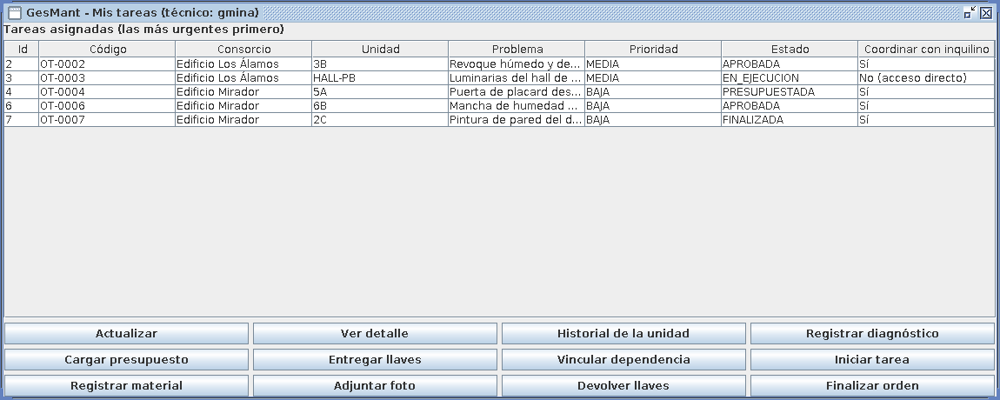
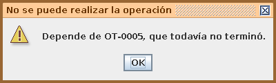
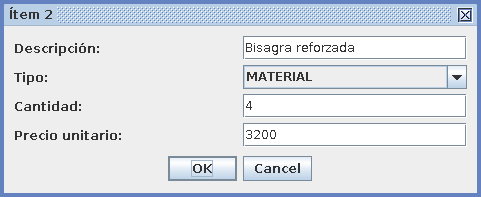
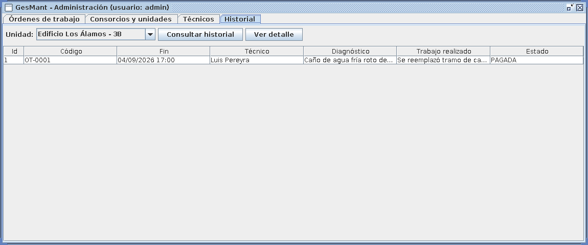
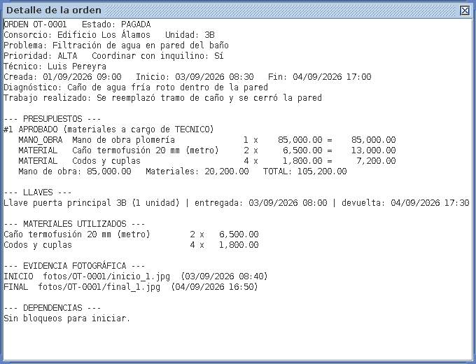

# GesMant - Prototipo

Sistema de gestión de órdenes de trabajo para mantenimiento edilicio.
Trabajo Práctico 2 - Seminario de Práctica (INF275) - Universidad Siglo 21.
Autor: Gabriel Fernando Mina.

Este repositorio contiene todo lo que el informe referencia: los scripts SQL, el código
del prototipo en Java, los diagramas y ejemplos de funcionamiento.

## Contenido

```
sql/
  01_creacion_tablas.sql          crea la base "gesmant" y sus 12 tablas
  02_insercion_datos.sql          datos de prueba (nombres ficticios)
  03_consultas.sql                consultas C1 a C10
  04_actualizacion_y_borrado.sql  ejemplos de UPDATE y DELETE, con verificación
src/main/java/gesmant/
  Main.java                       punto de entrada
  modelo/                         clases del dominio (OrdenTrabajo, Presupuesto, ...)
  datos/                          Conexion y clases DAO (acceso a MySQL con JDBC)
  logica/                         GestorOrdenes: reglas del negocio
  vista/                          pantallas Swing (login, administración, técnico)
  pruebas/PruebasSistema.java     32 casos de prueba automáticos
docs/
  diagramas/                      diagramas UML y DER
  capturas/                       pantallas del prototipo
pom.xml                           proyecto Maven (solo depende de mysql-connector-j)
```

## Scripts SQL

| Script | Entregable | Contenido |
|---|---|---|
| `01_creacion_tablas.sql` | Creación de las tablas | Base `gesmant`, 12 tablas con claves primarias, foráneas, `UNIQUE` y `CHECK`. Cada tabla está comentada. |
| `02_insercion_datos.sql` | Inserción de registros | 2 consorcios, 7 unidades, 3 técnicos, 3 usuarios y 8 órdenes en distintos estados, con presupuestos, llaves, materiales, fotos y dependencias. |
| `03_consultas.sql` | Consulta / presentación de consultas | C1 listado de órdenes, C2 tareas de un técnico, C3 total de presupuestos, C4 historial de una unidad, C5 llaves sin devolver, C6 dependencias, C7 órdenes por estado, C8 gasto en materiales por consorcio, C9 presupuestos pendientes, C10 técnicos disponibles. |
| `04_actualizacion_y_borrado.sql` | Actualización y borrado | Asignar, aprobar, devolver llaves; borrar una foto, una orden cargada por error (con `ON DELETE CASCADE`) y un técnico sin órdenes; verificación final con `SELECT`. |

Se ejecutan en MySQL Workbench o phpMyAdmin (XAMPP) en el orden indicado.

## Cómo ejecutar el prototipo

1. Iniciar MySQL (por ejemplo con XAMPP) en `localhost:3306`.
2. Ejecutar `sql/01_creacion_tablas.sql` y `sql/02_insercion_datos.sql`.
3. Si el usuario o la clave de MySQL no son `root` / vacía, cambiarlos en `datos/Conexion.java`.
4. Abrir la carpeta como proyecto Maven en IntelliJ IDEA o NetBeans (descarga el driver solo).
   Sin Maven: agregar `mysql-connector-j-8.x.jar` a las librerías del proyecto.
5. Ejecutar `gesmant.Main`.

| Usuario  | Clave    | Rol           |
|----------|----------|---------------|
| admin    | admin123 | Administrador |
| gmina    | tec123   | Técnico       |
| lpereyra | tec123   | Técnico       |

## Ejemplos de funcionamiento

Todos los ejemplos parten de la base recién cargada con los scripts 01 y 02.

**1. Inicio de sesión (CU01).** Según el rol, se abre la ventana de administración o la del técnico.
Con una clave incorrecta aparece "Usuario o clave incorrectos".


**2. Administración: órdenes (CU02, CU03, CU08, CU16).** Se ven las 8 órdenes con su estado.
- *Nueva orden*: elegir unidad 1A, escribir el problema y la prioridad -> se crea `OT-0009` en estado REGISTRADA.
- *Asignar técnico*: seleccionar OT-0009 y elegir "Gabriel Mina" -> pasa a ASIGNADA.
- *Aprobar presupuesto*: seleccionar OT-0004 (PRESUPUESTADA) -> pasa a APROBADA.
- *Verificar y habilitar pago*: seleccionar OT-0007 (FINALIZADA) -> pasa a PAGADA.


**3. Técnico: iniciar una tarea con dependencia (CU09).** Ingresar como `gmina`.
- Seleccionar OT-0006 y pulsar *Iniciar tarea* -> se rechaza: depende de OT-0005, que no terminó.
- Seleccionar OT-0002 y pulsar *Iniciar tarea* -> se inicia, porque OT-0001 terminó el 04/09 y ya pasaron las 72 h de secado.



**4. Técnico: presupuesto (CU06, CU07).** Sobre una orden ASIGNADA: *Registrar diagnóstico* y luego
*Cargar presupuesto*, agregando ítems de mano de obra y materiales. La orden pasa a PRESUPUESTADA.
Si se intenta presupuestar sin diagnóstico, el sistema lo impide.


**5. Técnico: finalizar (CU14, CU15).** Sobre OT-0003 (EN_EJECUCION):
- *Finalizar orden* -> se rechaza porque hay una llave sin devolver. Si se devuelve la llave pero falta la foto de la etapa FINAL, también se rechaza.
- *Devolver llaves*, *Adjuntar foto* (etapa FINAL) y *Finalizar orden* -> pasa a FINALIZADA.

**6. Historial y detalle (CU17).** En la pestaña *Historial*, elegir "Edificio Los Álamos - 3B" ->
aparece OT-0001. *Ver detalle* muestra presupuestos, llaves, materiales, fotos y dependencias.



## Pruebas

Volver a cargar los scripts 01 y 02 (las pruebas modifican datos) y ejecutar
`gesmant.pruebas.PruebasSistema`. Debe mostrar `32 correctas, 0 fallidas`.
Incluye el caso CPF04 del informe (partición de equivalencia y valores de frontera
sobre las 72 h de espera: -1, 0, 1, 71, 72 y 73 horas).

## Alcance del prototipo

Es un prototipo operacional (Kendall y Kendall, 2011): una aplicación de escritorio Java que
reúne las funciones del módulo de administración y las del técnico. En la versión final las
funciones del técnico pasan a una app Android y el acceso a datos a una API REST.
Las fotos se registran solo por su ruta y las claves se guardan en texto plano solo por
tratarse de un prototipo.
